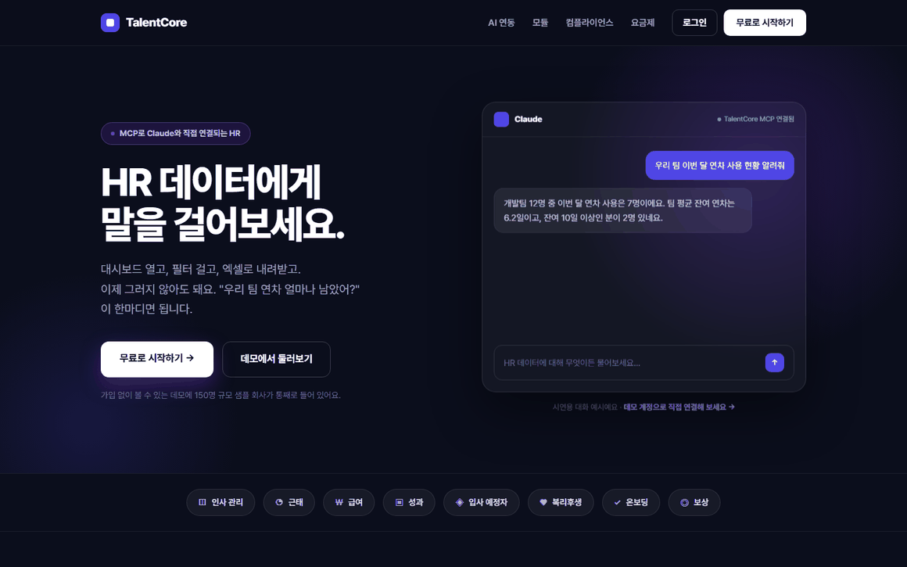
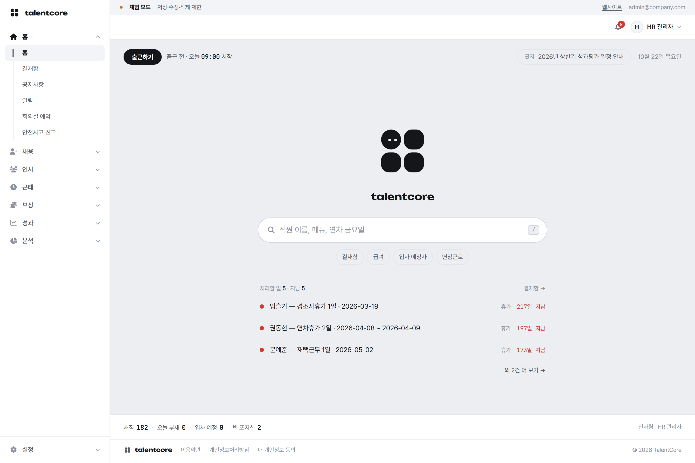
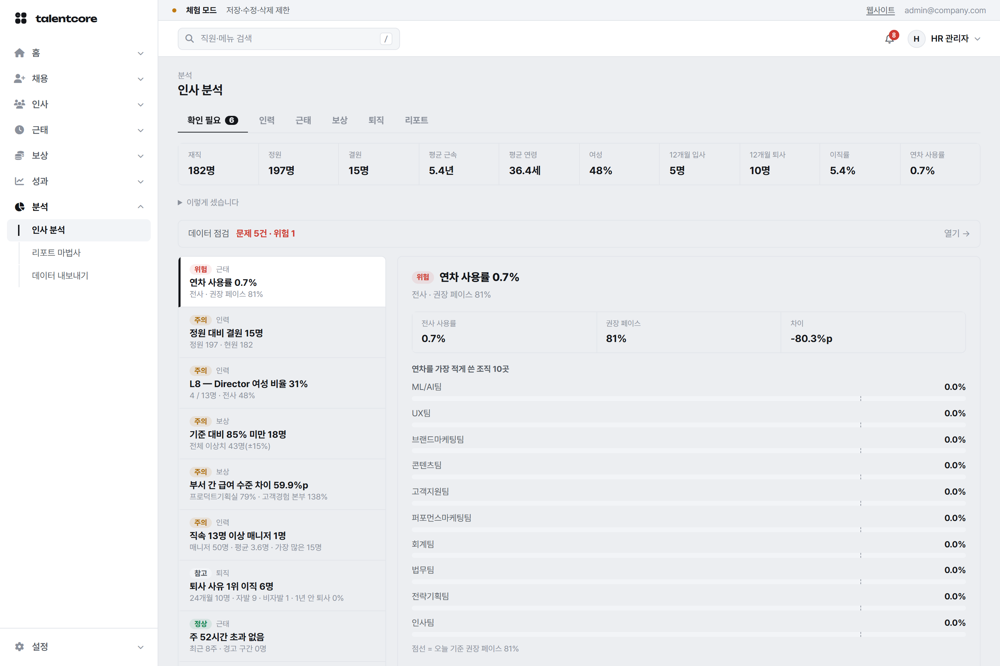
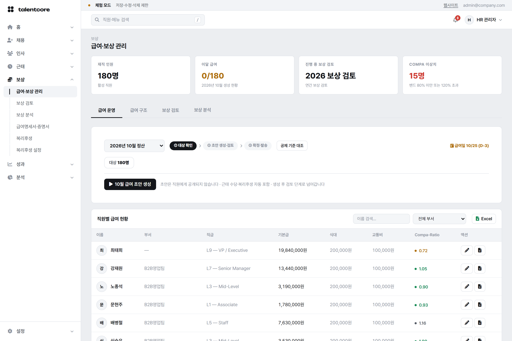
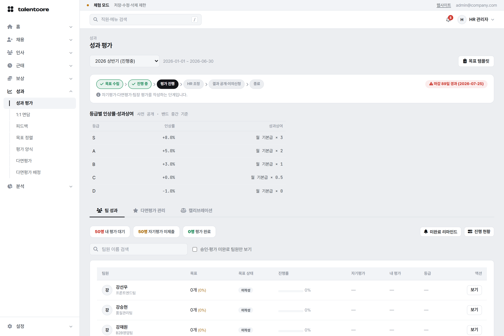
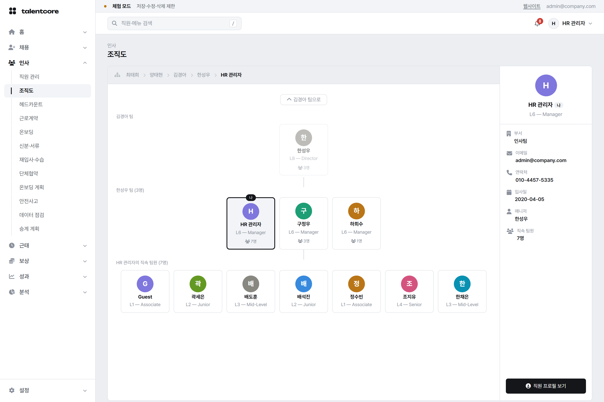
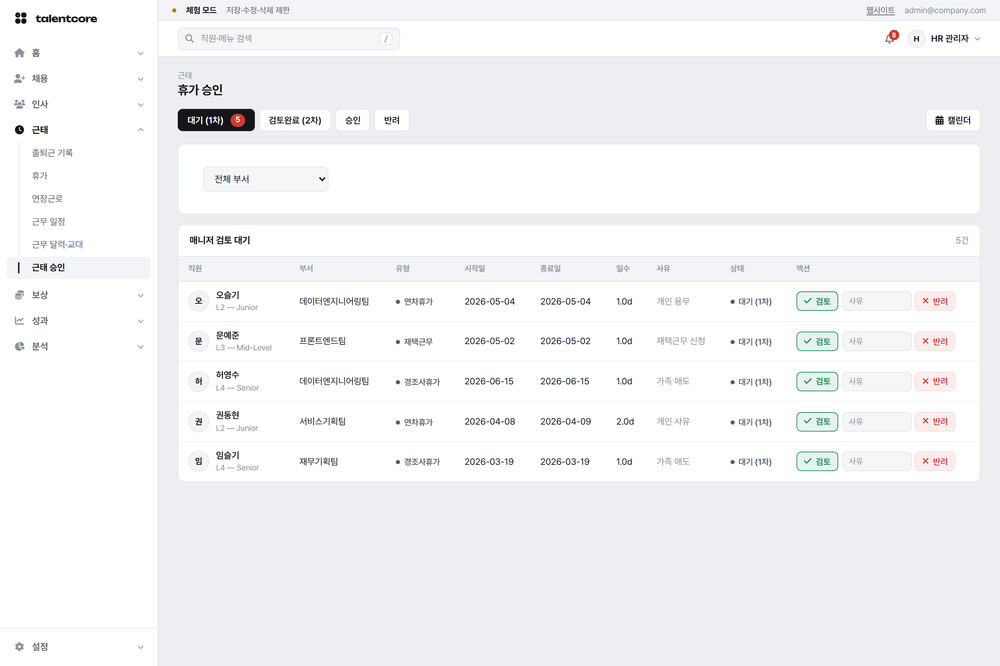

# TalentCore — 한국형 HR 플랫폼 (Core)

> 직원·조직·근태·급여·성과를 한 곳에서. 근로기준법을 기본 동작으로 지킵니다.
> Flask + SQLite · 비전공자 HR 주니어가 Claude Code 로 단독 개발


**라이브 데모:** https://talentcore.duckdns.org → 랜딩에서 **[데모 보기]**
가입 없이 관리자 권한으로 모든 화면을 둘러볼 수 있습니다(읽기 전용, 저장·수정 차단). 약 180명 규모의 샘플 회사가 들어 있습니다.



---

## TalentCore Suite 안에서의 자리

Core 는 제품군의 **중심 장부**입니다. 사람·조직·계정은 Core 가 갖고, 다른 제품은 Core 계정으로 로그인합니다(SSO).

| 제품 | 하는 일 | Core 와의 연결 |
|---|---|---|
| **Core** (이 저장소) | 인사·근태·급여·성과·조직·헤드카운트 | 계정·명부·결재의 원본 |
| Hire | 채용(공고·후보자·면접·오퍼) | Core 의 승인된 요청서 → 공고, 오퍼 수락 → 입사 예정자 |
| Screen | 녹화 영상 AI 면접 | Hire 후보자에게 링크 발송 |
| Grow | 직무 교육(연습 회사에서 진짜 화면으로 실습) | 수료 기록이 Core 프로필에 남음 |
| Minutes | 회의 녹음·화자별 기록 | Core 계정으로 로그인 |

채용 기능은 Hire 로 옮겼습니다. Core 에는 **채용 요청서(인력 충원)·결재·포지션**만 남아 있습니다.

---

## 스크린샷

| | |
|:---:|:---:|
|  |  |
| **홈**: 출퇴근 · 검색 · 처리할 일 | **인사 분석**: 확인 필요 항목 · 분야별 탭 |
|  |  |
| **보상**: 급여 밴드 · Compa-Ratio | **성과**: 명단 · 다면평가 · 캘리브레이션 |
|  |  |
| **조직도**: 보고 라인 · 인물 패널 | **근태**: 출퇴근 · 주 52시간 · 휴가 |

---

## 주요 기능

### 인사 기본
- **직원 정보:** 사번이 모든 기록의 열쇠(엑셀·API·내보내기 전부 사번 기준). 개인 정보·연락처·비상 연락처·사진, 동료 공개 범위 설정
- **변경 이력:** 누가 언제 어떤 칸을 무엇에서 무엇으로 바꿨는지 사람별로 남음
- **신분·서류:** 주민번호·여권·비자를 암호화해 저장하고 화면에는 가린 값만 표시. 전체 보기는 사유 입력 + 감사 로그. 만료 30·7·0일 알림
- **장애인 고용:** 의무 고용률 대비 현황(중증 2배 등 산정 규칙 반영, 참고용 추정)
- **재입사·수습:** 같은 사번으로 재입사, 근속 구간 보관. 수습 연장·판정·종료 알림. 중복 계정 찾기·합치기
- **개인정보 동의:** 필수 안내·선택 동의 관리, 판이 바뀌면 다시 동의. 철회하면 해당 값 삭제
- **인사 발령:** 미래 날짜 예약 · 승인 시 반영 · 퇴직 처리 3단계 + 퇴직금 계산
- **CSV 일괄 등록·수정:** 내보내기 → 엑셀에서 고치기 → 다시 올리기

### 조직·헤드카운트
- 조직 트리(부문 → 본부 → 실 → 팀), 조직 코드, 이름 바꾸기·옮기기·닫기·해체 이력
- 직급(CL1~CL9) · 관리 단계 · 직무군 · 급여 밴드
- **헤드카운트:** 조직마다 정원·재직·빈 포지션, 빈 포지션이 어디까지 진행됐고 며칠째인지
- **채용 요청서:** 결재선(C레벨·대결·본인 결재 회피) → 승인 → 포지션 → Hire 로 보내기
- **단체협약:** 협약 대장 · 적용 대상 자동 계산 · 만료 알림 · 조합원 기록(기본 꺼짐)
- **권한 묶음:** 관리자가 아닌 사람에게 특정 화면만 열어 주기

### 근태·휴가
- 출퇴근 · 근무 형태(고정·선택·재량·단축) · 연장·야간·휴일 수당 계산
- 주 52시간 실시간 감시 · 법정 휴게시간 자동 공제
- 휴가 13종 · 연차 자동 발생·이월 · 연차 사용 촉진 기록
- **근무 달력·교대:** 사업장별 달력(공휴일 + 회사 휴일), 주간·야간·교대 패턴 배정

### 급여·보상
- 급여명세서(4대보험 + 소득세 · 비과세) · 초안 → 확정 2단계(확정해야 직원에게 공개)
- 급여 밴드 · Compa-Ratio · Merit Matrix · 연봉 조정(조정안 → 시뮬레이션 → 반영)

### 성과
- 주기(목표 → 평가 → 캘리브레이션 → 이의 신청 → 종료)
- **평가 명단:** 대상·제외(입사 N개월 미만·퇴사 예정·인턴)·평가자 자동 채움, 사람이 고친 줄은 유지
- **다면평가 자동 배정:** 같은 부서 → 같은 상위 조직 → 전사 순, 평가자 부담 분산
- **진행 현황·독촉:** 사람마다 남은 일을 한 통으로
- **캘리브레이션 회의:** 조직 단위 회의 자동 구성 · 사전 자료 · 결과 일괄 입력(하향은 1단계까지·사유 필수) · 결과 공개
- 1:1 면담 · 피드백 · 목표 정렬 · 9박스 · 승계 계획(핵심 포지션별 후보·준비도)

### 입사·온보딩·근무 환경
- 입사 예정자 등록(직접·CSV·Hire 연동) → 직원 전환
- **입사일 규칙:** 매주 월·수만, 그날 오리엔테이션 교육장 자동 예약
- **온보딩 계획:** 부서·직급·직무 조건별 할 일·안내·영상
- **회의실:** 건물·층·방·예약표, 면접실 추천(Hire 연동)
- **안전사고:** 누구나 신고 → 담당자 처리. 산업재해조사표 대상이면 기한 알림

### 분석·내보내기
- **인사 분석:** 확인 필요 항목을 위험·주의·참고로 분류(연차 사용률·주 52시간·결원·직급별 여성 비율·보상·이직률·관리 폭·내부 이동률·퇴사 사유·후보 없는 핵심 포지션). 숫자마다 "이렇게 셌습니다" 설명
- **리포트 마법사:** 칸을 골라 거르고 엑셀로 내보내기 (Enterprise)
- **데이터 점검:** 사번·매니저·부서 빠짐, 끝난 계약인데 재직 등 문제 목록 → 줄마다 [고치기]
- 증명서 발급(재직·경력·퇴직·원천징수) · 정해진 엑셀 내보내기 · 감사 로그

---

## 근로기준법 대응

| 근거 | 동작 |
|---|---|
| §50 · §53 | 주 52시간 실시간 계산, 넘기 전에 본인·매니저·인사팀 경고 |
| §54 · §56 | 휴게시간 자동 공제, 연장·야간·휴일 가산 수당 계산 |
| §60 · §61 | 연차 자동 발생·이월, 연차 사용 촉진 발송 기록 |
| §48 | 급여 확정 시 명세서 공개(교부 의무) |
| 최저임금법 · 퇴직급여법 | 최저임금 미달 경고, 퇴직금·미사용 연차 수당 정산 |
| 노조법 §35 | 단체협약 일반적 구속력 검토 대상 표시 |
| 산업안전보건법 | 산업재해조사표 대상 사고 기한(사고일 + 1개월) 알림 |
| 개인정보보호법 | 동의 기록 · 철회 시 삭제 · 민감 정보 암호화 · 열람 감사 로그 |

> 급여·세액·고용률 계산은 참고용 자동 계산이며, 최종 확정은 담당자가 검토합니다.

---

## 요금제

| 요금제 | 1인 월 | 더 열리는 것 |
|---|---|---|
| Core | ₩2,500 | 인사·근태·급여·증명서·전자결재·문서함·입사 예정자 |
| Growth (가입 기본) | ₩4,500 | + 성과·온보딩·복리후생·다면평가 |
| Enterprise | ₩7,000 | + 승계 계획·Talent Card·급여 구조·리포트 마법사 |

1:1 면담·피드백·목표 정렬·다면평가·승계 계획은 회사 설정에서 따로 켜는 부가 기능입니다.

---

## Claude 연결 (MCP)

MCP 서버(`mcp_server.py`)를 Claude Desktop 에 연결하면 자연어로 HR 데이터를 조회할 수 있습니다.

- **읽기 전용 도구 8개:** 내 연차 잔액 · 내 급여명세 · 팀 근태 · 팀 인원 · 결재 대기 · 성과 현황 · 온보딩 현황 · 직원 검색
- 접속 계정 권한(관리자·매니저·직원)만큼만 답합니다. 쓰기 도구는 없습니다.

```json
{
  "mcpServers": {
    "talentcore": {
      "command": "python",
      "args": ["mcp_server.py"],
      "env": { "TALENTCORE_USER_EMAIL": "admin@company.com" }
    }
  }
}
```

---

## 역할

| 역할 | 범위 |
|---|---|
| HR Admin | 전체 |
| Manager | 자기 조직 아래 사람의 근태 승인·성과·결재·헤드카운트 |
| Recruiter | 채용 요청서·포지션·헤드카운트 |
| Employee | 본인 정보·근태 신청·급여명세·증명서·동의 |

권한 묶음으로 관리자가 아닌 사람에게 특정 화면(신분·서류, 단체협약, 데이터 점검 등)만 열 수 있습니다.

---

## 기술 구성

| 항목 | 내용 |
|---|---|
| Backend | Python 3.12+ · Flask 3.1 · Gunicorn |
| Database | SQLite(ORM 없음) · 회사(테넌트)마다 DB 파일 분리 · `master.db` 에 회사·요금제 |
| Frontend | 서버 렌더 HTML · Vanilla JS · 자체 CSS(Pretendard) · 다크/라이트 |
| 보안 | 세션 기반 역할 권한 · CSRF 전면 적용 · 민감 칸 Fernet 암호화 · 감사 로그 · 계정 잠금 |
| 연동 API | `X-API-Token` 서버 간 API(명부·요청서·입사 예정자·회의실) · 제품별 SSO 표 |
| 외부 연동(선택) | Slack · Jira/Confluence · SMTP |
| 배포 | Oracle Cloud VM · Nginx · Let's Encrypt |

---

## 로컬 실행

```bash
git clone https://github.com/Humgut1/hr-system.git
cd hr-system
pip install -r requirements.txt
python migrate_db.py   # 빈 DB 에 샘플 회사 데이터 생성 (운영 DB 에서는 절대 실행 금지 — 덮어씀)
python run.py          # http://localhost:5000
```

### 환경 변수 (`.env`, 선택)

없으면 외부 연동은 데모 모드로 동작합니다.

```env
HR_SECRET_KEY=...        # 세션 비밀값 (운영 필수)
HR_FIELD_KEY=...         # 주민번호·서류 번호 암호화 열쇠 (잃으면 복호화 불가 — 따로 보관)

SLACK_BOT_TOKEN=xoxb-...
JIRA_EMAIL=you@example.com
JIRA_API_TOKEN=...
JIRA_BASE_URL=https://yoursite.atlassian.net
SMTP_HOST=smtp.gmail.com
SMTP_PORT=587
SMTP_USER=you@example.com
SMTP_PASSWORD=...
```

DB 파일·`.env`·`private_uploads/` 는 저장소에 올리지 않습니다.

---

## 개발 배경

비전공자 HR 주니어가 Claude Code 로 단독 개발했습니다. Workday·Greenhouse 같은 글로벌 HRIS 를 기준으로 빠진 기능을 대조해 채우고, 한국 노동법을 기본 동작으로 넣는 것을 목표로 했습니다.

---

## License

MIT. 자유롭게 자체 호스팅·수정할 수 있습니다.
개인정보처리방침(`/privacy`)·이용약관(`/terms`)은 운영 인스턴스 기준 문서이므로, 자체 호스팅할 때는 운영자가 직접 작성해야 합니다.
